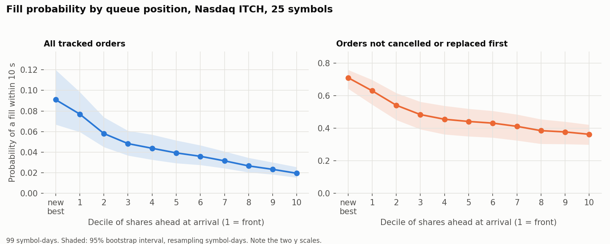

# Nasdaq-Faithful Matching Engine

A C++20 ITCH 5.0 order book and price-time matcher, checked against Nasdaq's own executions.
ITCH shows resting orders and the executions against them, never the incoming order. This project
infers each incoming order, asks the matcher what it would have filled on the book just before, and
compares the answer with what Nasdaq actually did. Every difference is traced to a named exchange
mechanism, and each mechanism is tested with a negative control. The book is then used to measure
what queue position is worth.

All numbers below are from Nasdaq's public TotalView-ITCH sample files
(https://emi.nasdaq.com/ITCH/Nasdaq%20ITCH/), not synthetic data.

## Results

**Full day, 2020-01-30: 423,285,709 messages, 8,915 symbols, one process, 240 s, 2.5 GB.**

| Check | Result |
| --- | --- |
| Book reconstruction | 0 unknown references, 0 overfills, 0 crossed books in continuous trading |
| Exact fill sequence predicted, plain price-time FIFO | 95.3% of 5,635,687 displayed-book events |
| After two rules found from the residuals (below) | 0 events unexplained, 0 audit residual |
| Same rules, unchanged, on 3 more days (25-symbol panel) | 0 unexplained, 0 audit residual on each |

What it took to get from 95.3% to zero residual, in events (`docs/scale-up-results.md`, "Ablation"):

| Model of the displayed queue | Not reproduced |
| --- | --- |
| Price-time FIFO in feed order, displayed fills scored on their own | 95,738 (1.70%) |
| plus: orders that execute at a better price than displayed fill first | 3,096 |
| plus: queue priority by entry order (reference number), not display order | 0 |

Two things a displayed-FIFO fill model gets wrong on Nasdaq, both measured here:

1. **Entry order beats display order at the open.** Orders accepted before the open are released to the
   book over roughly the first 40 seconds after the opening cross, and they queue by when they were
   entered: 316,692 of them land ahead of orders that were displayed earlier. Switch that rule off and
   2,844 events go unexplained.
2. **Displayed price is not always the working price.** In 92,645 events (1.3% of continuous events),
   orders displayed at one price execute at a better one and fill ahead of the displayed queue. This
   matches Nasdaq's Price to Comply order type (Rule 4702(b)(1): displayed one increment away, ranked at
   a non-displayed price). The first version of this project reported "0 unexplained" without checking
   those events; an audit added later found them. That story is in `docs/engineering-log.md`.

**Queue position** (25 symbols, 4 days, 14.4M orders at the touch, `docs/queue-results.md`):



- Front-decile orders fill within 10 s 3.9 times as often as back-decile orders (95% interval 3.1 to 5.1).
  The effect survives controls for imbalance, spread, size and time of day, at a little over half its raw size.
- No back-of-queue markout penalty: -0.70 bps (interval -1.60 to +0.09). The sign flips between
  tick-constrained and wider-spread symbols.
- 2.5% of fills happen at a better price than displayed, outside the displayed queue.
- Predictions were committed before each run. Of 9 for the queue study, 2 were wrong and 1 was not supported;
  of the scale-up predictions, 6 were wrong. All are scored in the docs.

**Tests.** An OCaml executable spec written first, differential fuzzing of the C++ engine against it, C++
property tests, libFuzzer under ASan and UBSan, and 28 seeded bugs, all caught
([`results/mutant_matrix.md`](results/mutant_matrix.md)). The audit has its own negative-control unit test.

**Performance.** Not a headline. The baseline book (`std::map` levels, `std::unordered_map` orders) replays
a real 12M-message extract at about 6.8M messages/s in a Linux VM on an M-series laptop. The "fast" paged
order lookup is faster on dense synthetic data and about 6 times slower on real data, where reference
numbers are sparse. That negative result and its diagnosis are in [`docs/perf-log.md`](docs/perf-log.md).

## What this is not

- Not a production matching engine: one order type (limit), no order entry gateway, no networking, no
  hidden or pegged orders. It is a book builder and a fill-model validator.
- "0 unexplained" does not mean every execution is predicted. The better-price rule reads the working
  price from the event's own messages, so it explains those executions after the fact.
- One full day and three 25-symbol panel days, from 2019 and early 2020.
- The opening-release description is inferred from the feed; no rule text was found for its sequencing.

## Run it

```sh
make test                                              # unit, property, equivalence, QCheck, 1M-op differential
make reproduce                                         # synthetic days, about 3 minutes, no data needed
make verify-real ITCH=data/01302020.NASDAQ_ITCH50      # the full real day against results/expected/, about 4 minutes
scripts/panel_day.sh data/12302019.NASDAQ_ITCH50       # 25-symbol panel pipeline for one day
python3 analysis/queue_panel.py out/panel/*/queue --out results/queue-real
```

Download a day from the Nasdaq link above and `gunzip` it into `data/` (about 13 GB). The ITCH files are
not in this repository.

## Layout

```
include/nfe/   itch.hpp (decoder) book.hpp fast_book.hpp matcher.hpp replay.hpp fidelity.hpp
src/tools/     nfe_replay nfe_fidelity nfe_queue nfe_lateadds nfe_trace nfe_bench nfe_engine nfe_extract nfe_stats
spec/          OCaml executable spec, protocol driver, QCheck properties
tests/         unit, property and book-equivalence tests; regressions/ from the fuzzer
fuzz/          difftest.py (differential), libFuzzer targets
mutants/       seeded bugs as patches, matrix runner
sim/           synthetic ITCH exchange with ground truth; fault injector
analysis/      queue study (queue_panel.py real data, queue_study.py synthetic), scale-up, grouping score, report
scripts/       panel_day.sh, verify_real.py, reproduce.sh, bench.sh, cpptrader_baseline.sh
docs/          writeup, scale-up results, queue results, predictions, engineering log, perf log
results/       numbers and figures; expected/ holds the full-day totals that verify-real checks
```

## Requirements

macOS or Linux, CMake 3.20+, a C++20 compiler (GCC 11 or later, or a recent Clang), OCaml 4.14 with dune and
qcheck-core, Python 3 with pandas, numpy, matplotlib and statsmodels. Sanitizers, libFuzzer and `perf`
counters need Linux; CI runs those.

```sh
brew install cmake opam && opam init -y && eval $(opam env) && opam install -y dune qcheck-core   # macOS
pip3 install pandas numpy matplotlib statsmodels
```

Further reading: [`docs/writeup.md`](docs/writeup.md) (claims, evidence, limits),
[`docs/scale-up-results.md`](docs/scale-up-results.md), [`docs/queue-results.md`](docs/queue-results.md),
[`docs/engineering-log.md`](docs/engineering-log.md).
