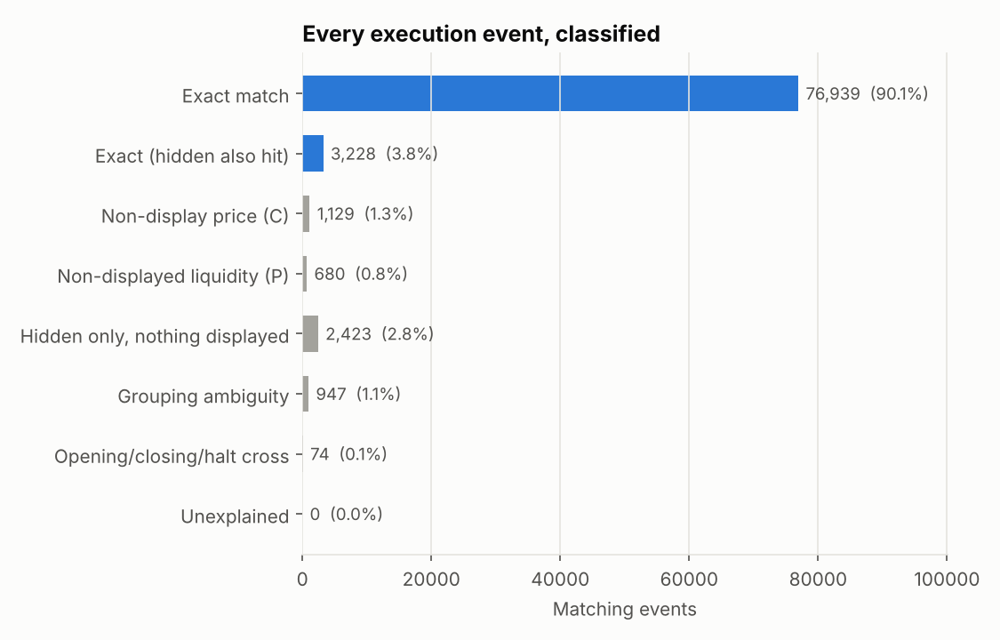
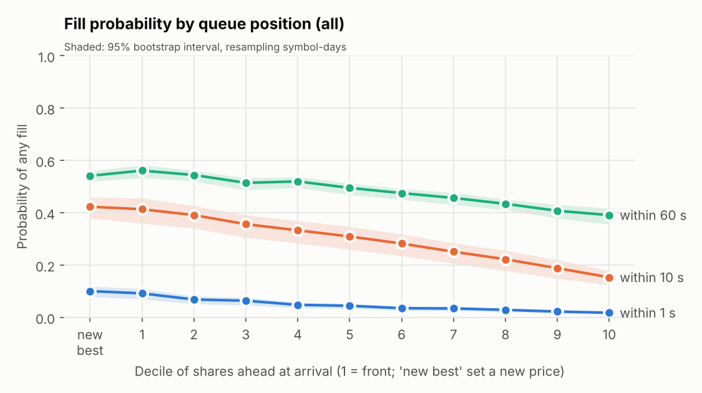
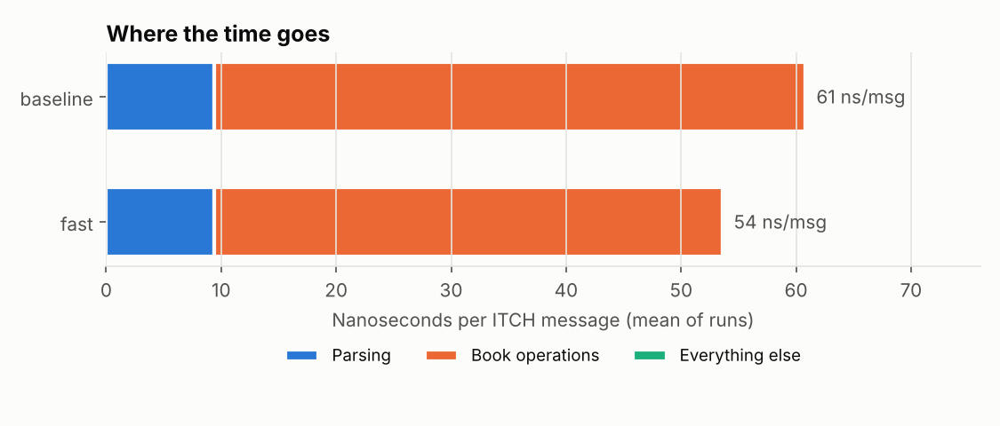

# Nasdaq-Faithful Matching Engine

A C++20 price-time matching engine that, run in matching mode, reproduces
Nasdaq's own displayed-book executions from a TotalView-ITCH 5.0 day and
assigns every execution it cannot reproduce to a named exchange mechanism.
It is then used to measure what queue position is worth.

> **Status:** every pipeline runs end to end. The numbers below come from
> **synthetic** ITCH days (`sim/itch_sim.py`), because the build environment
> could not download Nasdaq's files. Run `make reproduce ITCH=...` on a real
> day to replace them.

| Fidelity | Seeded bugs caught | Throughput |
| --- | --- | --- |
| **96.7%** exact match, **0** unexplained | **28 / 28** | **1.44x** CppTrader's market manager |





```sh
make reproduce                                   # synthetic days, ~3 minutes
make reproduce ITCH=data/01302020.NASDAQ_ITCH50 SYMBOLS=AAPL,MSFT,...   # a real day
```

Full numbers: [`results/REPORT.md`](results/REPORT.md). Claims, evidence and
limits: [`docs/writeup.md`](docs/writeup.md). How it was built and what went
wrong: [`docs/engineering-log.md`](docs/engineering-log.md).

## The four pillars

**Fidelity.** ITCH shows resting orders and executions against them, never
the incoming order. `nfe_fidelity` groups executions into matching events,
infers the aggressor (side, size, limit), rewinds to the pre-event book, and
asks the matcher what that order would have filled. Differences are
classified: hidden liquidity (P), non-display price (printable C), crosses,
grouping ambiguity, unexplained. On synthetic days, where every aggressor is
known, the grouping heuristic is scored against the truth.

**Test power.** An OCaml executable spec, written first, with QCheck
properties of its own; differential fuzzing of the C++ engine against it;
C++ property tests; libFuzzer on the parser and engine under ASan/UBSan; and
a matrix of 28 hand-seeded bugs against three validators
([`results/mutant_matrix.md`](results/mutant_matrix.md)).

**The finding.** Fill probability within 1/10/60 s and markouts at
100 ms/1 s/10 s by decile of shares ahead at arrival, with intervals
bootstrapped by symbol-day, split by tick-constrained vs wider-spread
symbols. Hypotheses are in the write-up and were fixed before running.

**Performance.** A baseline (`std::map` + `std::unordered_map`) and a final
design changed one step at a time with a written prediction each
([`docs/perf-log.md`](docs/perf-log.md)), measured against CppTrader on the
same file and machine.

## Layout

```
include/nfe/   itch.hpp (decoder) book.hpp fast_book.hpp matcher.hpp replay.hpp fidelity.hpp
src/tools/     nfe_replay nfe_fidelity nfe_queue nfe_bench nfe_engine nfe_extract nfe_stats
spec/          OCaml executable spec, protocol driver, QCheck properties
tests/         unit, property and book-equivalence tests; regressions/ from the fuzzer
fuzz/          difftest.py (differential), libFuzzer targets
mutants/       seeded bugs as patches, matrix runner
sim/           synthetic ITCH exchange with ground truth; fault injector
analysis/      grouping score, close check, queue study, report
scripts/       reproduce.sh, bench.sh, cpptrader_baseline.sh
```

## Requirements

Linux, CMake 3.20+, GCC 13 or Clang 18, OCaml 4.14 with dune and
qcheck-core, Python 3 with pandas, numpy and matplotlib. Benchmarks want
`perf` with hardware counter access. On Ubuntu 24.04:

```sh
sudo apt-get install cmake g++ clang libclang-rt-18-dev ocaml ocaml-dune libqcheck-core-ocaml-dev ocaml-findlib
pip install pandas numpy matplotlib
make test
```

## Non-goals

Networking, multi-threaded matching, persistence, a GUI, trading strategies,
batch auctions.
