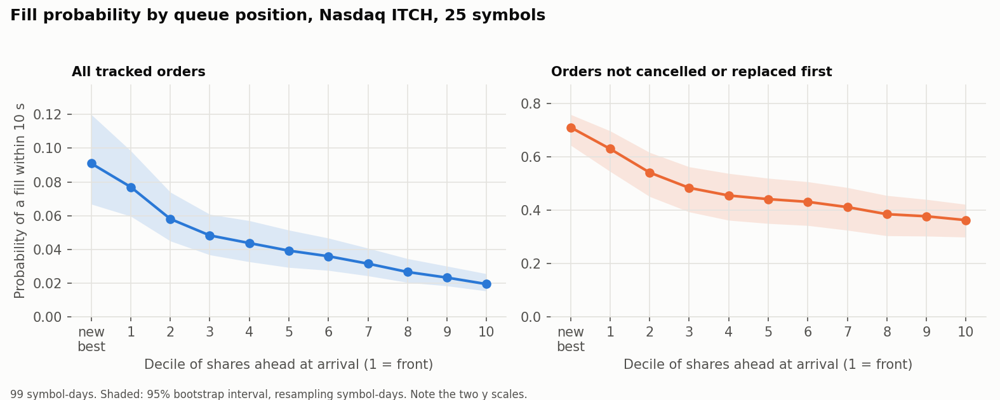

# Queue study results (2026-11-23)

Predictions were committed first (`docs/predictions-queue.md`, commit 9ff26a5). This file scores them.
Code: `src/tools/nfe_queue.cpp` (tracking) and `analysis/queue_panel.py` (analysis). Numbers: `results/queue-real/`.

## What was run

- 25-symbol panel, four days (2019-01-30, 2019-08-30, 2019-12-30, 2020-01-30): 99 symbol-days (LINX has no tracked
  orders on 2019-01-30).
- Every displayed order added at the best bid or ask in continuous trading, arriving 09:31:00 to 15:59:00:
  14,410,632 orders (12,287,570 joined an existing level, 2,123,062 set a new best price) and 915,002 fills.
- Deciles rank shares ahead at arrival among joiners, within each symbol-day. Decile 1 is the front.
- Intervals are 95% percentile bootstraps over whole symbol-days (1,000 draws).

## Results

**Fill probability.** Within 10 s, 7.7% of front-decile joiners get a fill against 2.0% of back-decile joiners:
a ratio of 3.9 (95% interval 3.1 to 5.1). It falls at every decile. Most orders are cancelled within seconds, so the
unconditional rates are low; among orders not cancelled or replaced first, the 10 s fill rate is 63% at the front
and 36% at the back.

| | New best | D1 | D2 | D3 | D4 | D5 | D6 | D7 | D8 | D9 | D10 |
| --- | --- | --- | --- | --- | --- | --- | --- | --- | --- | --- | --- |
| Fill within 1 s | 7.6% | 5.7% | 4.0% | 3.2% | 2.8% | 2.4% | 2.1% | 1.8% | 1.5% | 1.3% | 1.1% |
| Fill within 10 s | 9.1% | 7.7% | 5.8% | 4.8% | 4.4% | 3.9% | 3.6% | 3.2% | 2.7% | 2.3% | 2.0% |
| Fill within 60 s | 9.5% | 8.2% | 6.3% | 5.3% | 4.8% | 4.4% | 4.0% | 3.6% | 3.0% | 2.6% | 2.2% |
| 10 s, if not cancelled first | 71% | 63% | 54% | 48% | 46% | 44% | 43% | 41% | 39% | 38% | 36% |
| 1 s markout, bps (positive = adverse) | 1.92 | 2.16 | 1.79 | 1.75 | 1.58 | 1.55 | 1.37 | 1.61 | 2.16 | 1.71 | 1.46 |

**With controls.** A linear probability model of a 10 s fill on log(1 + shares ahead), with symbol-day fixed effects
and errors clustered by symbol-day (20% sample of joiners, 2,459,807 orders, 97 symbol-days): the coefficient is
-0.0158 (se 0.0027) alone and -0.0089 (se 0.0022) after adding imbalance toward the order's side, spread in ticks,
log order size and hour of day. The controls take away a little under half of the raw effect; what is left is
still about four standard errors from zero. Mean 10 s fill rate in that sample: 4.0%.

**Markouts: no back-of-queue penalty.** The 1 s markout of back-decile fills minus front-decile fills is -0.70 bps
(interval -1.60 to +0.09): if anything the back does better, and the interval includes zero. The sign depends on the
regime:

| Symbol-days | Front/back 10 s fill ratio | Back minus front 1 s markout, bps |
| --- | --- | --- |
| Tick-constrained (median spread one tick), 44 | 5.4 (4.4 to 6.6) | -1.00 (-1.94 to -0.23) |
| Wider spread, 55 | 1.6 (1.3 to 2.0) | +0.67 (+0.08 to +2.08) |

In tick-constrained names front-of-queue fills are the more adverse ones; in wider-spread names it is the back. A
possible reading, not tested: in a one-tick market, "few shares ahead at arrival" often means joining a level that
is nearly gone, which is exactly when the price is about to move through it. Shares ahead at arrival mixes "early
at a fresh level" with "late at a dying level", and the study does not separate them.

**New best price.** Orders that set a new best price fill within 10 s 1.4 points more often than front-decile
joiners (interval -0.7 to +3.3 points). Their 1 s markout is 1.92 bps against 2.16 for the front decile and 1.58
for decile 5; neither difference has an interval that excludes zero.

**Better-price fills.** 22,647 of 915,002 tracked fills (2.5%; 2.4% of shares) happen at a price different from
the order's displayed price. These are the orders the fidelity audit found filling ahead of the displayed queue.
Dropping the 18,010 orders involved moves the front/back ratio from 3.9 to 4.5 (interval 3.5 to 6.0), because they
fill regardless of their displayed position and are spread across the deciles. So a queue model built on displayed
position alone understates the value of queue position slightly.

**By tier** (front/back ratio of 10 s fill probability): bridge symbols 3.7 (2.6 to 4.9), tier 1 4.6 (2.8 to 6.8),
tier 2 7.6 (4.8 to 12.2), tier 3 2.0 (1.4 to 3.1), tier 4 3.5 (2.0 to 4.2). Tier 4 has only 33,252 orders over 19
symbol-days.

## Predictions scored

| # | Prediction | Confidence | Result | Score |
| --- | --- | --- | --- | --- |
| 1 | 10 s fill, front over back decile between 1.5x and 4x | 70% | 3.9x (3.1 to 5.1) | right, at the edge |
| 1a | Front fills more often than back | 95% | yes, at every decile | right |
| 2 | Back-of-queue fills have worse 1 s markouts | 60% | -0.70 bps: back is better at the point estimate | **wrong** |
| 2a | That interval excludes zero | 40% | -1.60 to +0.09, does not exclude zero | the more likely outcome happened |
| 3 | New-best orders fill more often than front-decile joiners | 60% | +1.4 points (-0.7 to +3.3) | right in direction, not distinguishable |
| 3a | Their 1 s markout is worse than joiners' | 70% | better than the front decile, worse than the middle; no interval excludes zero | **not supported** |
| 4 | Better-price fills are 1% to 5% of tracked fills | 60% | 2.5% | right |
| 5 | Shares-ahead effect stays negative after controls | 90% | -0.0089, se 0.0022 | right |
| 6 | Tier 4: interval includes 1 | 70% | 3.5 (2.0 to 4.2), excludes 1 | **wrong** |

Null result (front/back interval includes 1): did not happen.

## Limits

- Four days, 25 symbols. The pooled numbers are dominated by the five bridge symbols and tier 1 (13.2M of the 14.4M
  orders). Bootstrap intervals resample symbol-days, so they reflect that, but four days is four days.
- The mid is Nasdaq's own best bid and offer, not the NBBO. A 1 s markout against a single venue's mid is noisy in
  names where Nasdaq is often not at the inside.
- Shares ahead is displayed shares at arrival. Hidden orders and better-price orders can fill ahead; cancels ahead
  improve position after arrival and are not tracked.
- Cancels are endogenous: an order that would have been filled adversely may be cancelled first. The "not cancelled
  first" row conditions on a post-arrival outcome and is descriptive only.
- The regression is a linear probability model on a 20% sample, a control exercise, not a causal estimate.
- Markouts are before fees and rebates. Net capture (half-spread earned minus 1 s markout) is negative in every
  decile, between -0.3 and -0.8 bps, which is what a passive order earns before the rebate.
- Prior work: Moallemi and Yuan, "A Model for Queue Position Valuation in a Limit Order Book" (Columbia Business
  School working paper, SSRN, 2017) model and calibrate queue value. This is a descriptive measurement on public
  data, not a model.
