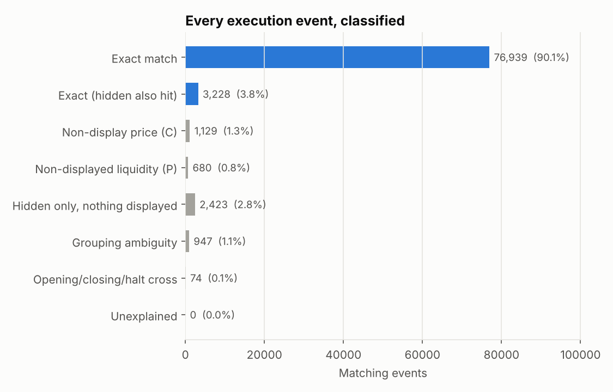
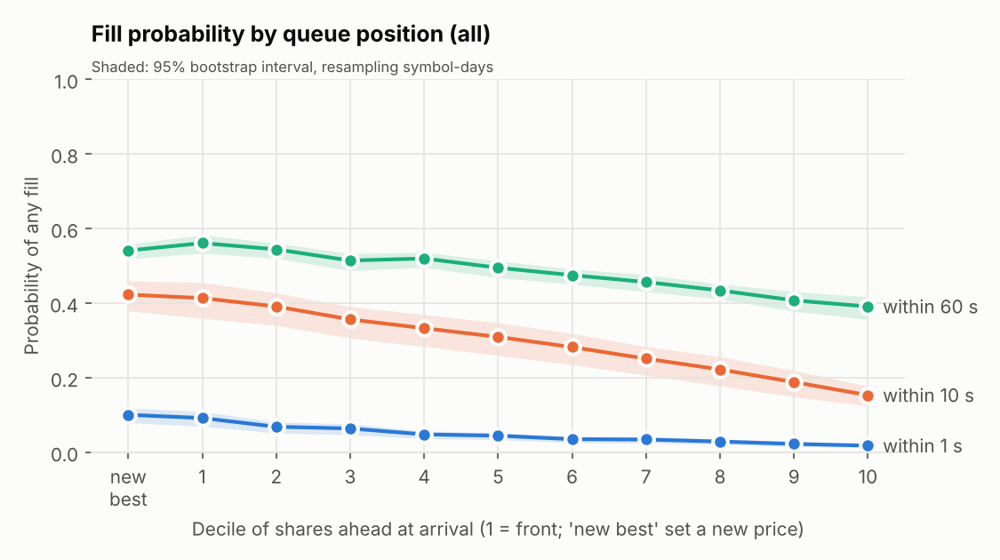
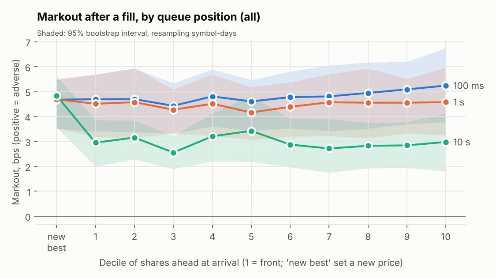
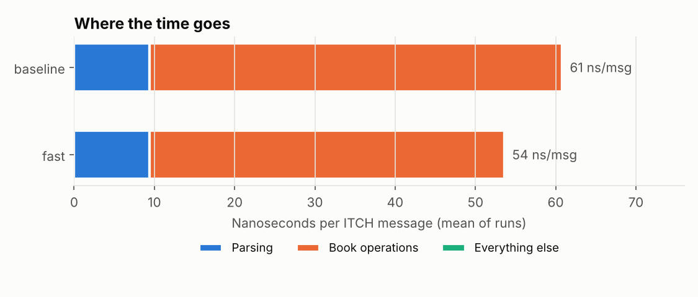

# Results - synthetic days

## Reconstruction

| Day | Messages | Unknown refs | Overfills | Crossed (continuous) | Crossed (other states) | Closing crosses matched |
| --- | --- | --- | --- | --- | --- | --- |
| synth1.itch | 213,238 | 0 | 0 | 0 | 3,558 | 8 of 8 |
| synth2.itch | 213,856 | 0 | 0 | 0 | 3,633 | 8 of 8 |
| synth3.itch | 213,628 | 0 | 0 | 0 | 3,758 | 8 of 8 |

## Fidelity

**Exact-match rate 96.68%** of displayed-book matching events in continuous trading (85,346 events); 97.37% for events with no hidden involvement. Unexplained: 0 (0.00%). Grouping ambiguity: 1.11%.

| Class | Events |
| --- | --- |
| Exact match | 76,939 |
| Exact (hidden also hit) | 3,228 |
| Non-display price (C) | 1,129 |
| Non-displayed liquidity (P) | 680 |
| Hidden only, nothing displayed | 2,423 |
| Grouping ambiguity | 947 |
| Opening/closing/halt cross | 74 |
| Unexplained | 0 |

| Group | Symbol-days | Events | Exact-match rate | Unexplained |
| --- | --- | --- | --- | --- |
| tick-constrained | 8 | 44,605 | 96.44% | 0 |
| wider spread | 16 | 40,741 | 96.93% | 0 |
| low activity | 9 | 17,343 | 97.18% | 0 |
| mid activity | 6 | 18,254 | 96.89% | 0 |
| high activity | 9 | 49,749 | 96.42% | 0 |

Grouping heuristic against ground truth (synthetic days only): 80,523 of 86,917 true aggressors recovered one-to-one (92.64%); every timestamp with several aggressors was flagged (3197 of 3197); posted remainders recovered 100.00% (worst day).

## Test power

| Mutant | Bug | Fuzzer | Properties | Replay | Caught |
| --- | --- | --- | --- | --- | --- |
| 01_partial_fill_off_by_one | a partial fill takes one share too few | ✓ 200 | ✓ 13 | ✓ 5,006 | ✓ |
| 02_buy_limit_strict | a buy does not trade at exactly its limit | ✓ 200 | ✓ 53 | ✓ 5,119 | ✓ |
| 03_sell_limit_strict | a sell does not trade at exactly its limit | ✓ 200 | ✓ 30 | ✓ 5,006 | ✓ |
| 04_side_comparison_swapped | wrong side comparison for the limit test | ✓ 200 | ✓ 4 | ✓ 5,278 | ✓ |
| 05_walks_own_side | aggressor matches against its own side | ✓ 200 | ✓ 3 | ✓ 5,006 | ✓ |
| 06_lifo_within_level | newest order at a price fills first | ✓ 200 | ✓ 30 | ✓ 5,006 | ✓ |
| 07_stops_after_one_level | sweep never goes past the first price level | ✓ 200 | ✓ 40 | ✓ 5,278 | ✓ |
| 08_fill_at_aggressor_limit | trades print at the aggressor's limit, not the resting price | ✓ 200 | ✓ 4 | ✓ 5,278 | ✓ |
| 09_rests_full_size | remainder rests with the original size | ✓ 200 | ✓ 18 | · | ✓ |
| 10_no_rest_after_partial | a partially filled order does not rest its remainder | ✓ 200 | ✓ 18 | · | ✓ |
| 11_replace_keeps_priority | replace at the same price keeps queue position | · | ✓ 59 | ✓ 6,413 | ✓ |
| 12_partial_cancel_loses_priority | a reduced order moves to the back of its queue | ✓ 200 | ✓ 62 | ✓ 5,006 | ✓ |
| 13_level_qty_not_reduced | level total not updated on a partial reduce | · | ✓ 2 | · | ✓ |
| 14_empty_level_kept | empty price levels are never removed | ✓ 200 | ✓ 5 | ✓ 5,003 | ✓ |
| 15_count_not_incremented | level order count stops at one | ✓ 200 | ✓ 27 | ✓ 5,005 | ✓ |
| 16_unlink_head_wrong | removing the head skips the next order too | ✓ 200 | ✓ 30 | ✓ 5,006 | ✓ |
| 17_unlink_tail_stale | tail not moved back when the newest order of several leaves | ✓ 200 | ✓ 51 | ✓ | ✓ |
| 18_bids_ascending | best bid is the lowest bid | ✓ 200 | ✓ 3 | ✓ 5,006 | ✓ |
| 19_duplicate_ref_accepted | a duplicate id overwrites the live order | · | · | ✓ 63,975 | ✓ |
| 20_push_front | new orders join the front of the queue | ✓ 200 | ✓ 27 | ✓ 5,006 | ✓ |
| 21_overfill_unchecked | executions larger than the order are not caught | · | · | ✓ 106,630 | ✓ |
| 22_cancel_deletes | a partial cancel deletes the whole order | · | · | ✓ 201 | ✓ |
| 23_exec_short_by_one | executions remove one share too few | · | · | ✓ 5,181 | ✓ |
| 24_halt_state_ignored | halts and quote-only periods count as continuous trading | · | · | ✓ 88,917 | ✓ |
| 25_add_price_offset | Add price read one byte early | · | · | ✓ 5,005 | ✓ |
| 26_replace_fields_swapped | Replace shares and price swapped | · | · | ✓ 5,108 | ✓ |
| 27_remainder_side_wrong | posted remainder looked for on the resting side | · | · | ✓ 213,238 | ✓ |
| 28_replace_flips_side | replace submits the new order on the other side | ✓ 200 | · | · | ✓ |

**28 of 28 seeded bugs caught.** Fuzzer 18, properties 19, replay 24; 10 caught by exactly one validator. Median operations to detection: fuzzer 200, properties 27. Cells show operations (or ITCH messages, for replay) until the first failure; · means not caught.

## Queue position

136,435 orders at the touch, 89,666 fills, 24 symbol-days. Point estimate [95% CI], bootstrapped by symbol-day.

- H1, fill probability falls with shares ahead: Spearman rho over deciles (10 s) -1.00 [-1.00, -1.00]; front decile fills 2.71x as often as the back [2.49, 3.02].
- H2, back-of-queue fills are more adversely selected: back minus front markout at 1 s +0.07 bps [-0.38, +0.56].
- H3, tick-constrained vs wider spread: front/back fill ratio 2.66 vs 2.84; back-minus-front markout +0.09 vs +0.13 bps.

## Performance

3,200,041 messages, 5 runs after a discarded warm-up, mean ± sd.

| Design | Replay (M msg/s) | Book only (M op/s) | p50 | p99 | p99.9 |
| --- | --- | --- | --- | --- | --- |
| baseline | 17.70 ± 0.98 | 19.24 ± 0.92 | 69 ns | 223 ns | 373 ns |
| fast | 19.49 ± 0.94 | 22.37 ± 0.30 | 50 ns | 166 ns | 372 ns |

Parse only: 106.4 M msg/s. Timer overhead (p50): 17 ns, included in the latencies above.

CppTrader market manager on the same file and machine: 13.56 M msg/s (median of 5). Ratio, this engine / CppTrader: **1.44x**. Work per message differs; see docs/perf-log.md.

